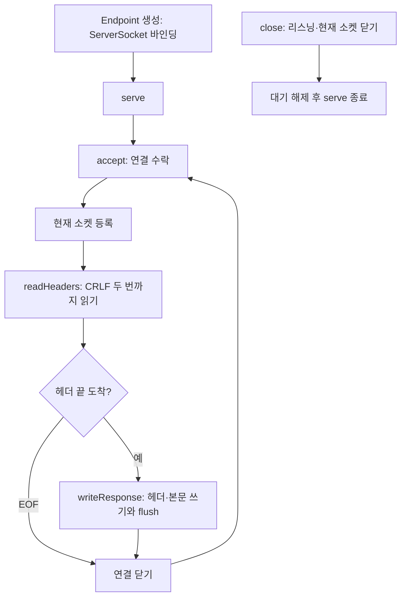

# 01-01. Endpoint와 요청 한 건의 흐름

## 이 단계의 목적

TCP 연결을 받아 HTTP 형식의 고정 응답을 보내고 연결을 닫는다. 같은 서버에서 두 번 요청·응답이 이어지는지 확인해 연결 하나의 종료와 서버 종료를 구분한다.

현재 [Endpoint](../../src/main/java/simpletomcat/util/net/Endpoint.java)는 헤더 끝 읽기·고정 응답까지 함께 담당한다. 2단계에서 HTTP 처리 부분을 Processor로 분리한다. [단계별 실제 기술 대응](../reference/03-learning-stage-mapping.md)을 함께 참고한다.

## 메서드 호출 흐름



소켓 입출력은 블로킹이다. `serve()`를 호출한 스레드가 `accept()`, 헤더 읽기, 응답 쓰기를 순서대로 수행한다. Endpoint가 작업 스레드를 생성하지는 않는다.

## 구현과 역할

| 메서드 | 역할 |
|---|---|
| `Endpoint(int port)` | ServerSocket 바인딩. 0이면 운영체제가 임시 포트를 배정 |
| `getPort()` | 바인딩된 실제 포트 반환 |
| `serve()` | 연결 수락·현재 소켓 등록·요청 처리·연결 정리 반복. 한 스레드에서 호출 |
| `readHeaders(InputStream)` | TCP 읽기 경계와 무관하게 `\r\n\r\n`까지 읽고 완료 여부 반환 |
| `writeResponse(OutputStream)` | 고정 응답 헤더와 UTF-8 본문을 쓴 뒤 flush |
| `close()` | 리스닝 소켓과 현재 연결을 닫아 accept·헤더 읽기를 해제 |
| `main(String[] args)` | 기본 포트 8080 또는 인자 포트로 실행, 종료 훅 등록 |

## 응답 규칙

```http
HTTP/1.1 200 OK
Content-Type: text/plain; charset=UTF-8
Content-Length: 22
Connection: close

Hello, simple-tomcat!
```

실제 헤더의 줄 끝은 CRLF이고 헤더·본문 사이에는 CRLF 두 번이 들어간다. 본문은 `Hello, simple-tomcat!\n`이며 마지막 LF까지 22바이트다. Content-Length는 문자열 글자 수가 아닌 UTF-8로 인코딩한 본문 배열 길이로 계산한다.

헤더 끝 전에 EOF가 오면 응답 없이 연결을 닫고 다음 연결을 받는다. 연결 하나의 IOException은 서버가 종료 중이 아니면 경고 로그를 남기고 다음 연결로 넘어간다. 메서드·경로·HTTP 문법을 검사하는 기능은 아직 없다.

## 연결 정리와 서버 종료

연결은 try-with-resources로 응답 처리 후 닫는다. `Connection: close`와 실제 연결 종료가 함께 동작한다.

`close()`는 여러 번 호출해도 안전하다. 현재 소켓 등록과 종료를 같은 잠금으로 보호해, 종료 시점에 수락한 연결도 읽기 대기에 남지 않게 한다. `close()`가 소켓을 닫으면 `serve()`가 반환하며, 호출 스레드의 종료를 기다리는 일은 호출자가 맡는다. 테스트는 Future로 이를 확인한다.

서버를 다시 실행하려면 새 Endpoint를 생성한다. 아직 작업 풀·읽기 타임아웃이 없어 느린 클라이언트 하나가 다음 연결 처리를 지연시킨다.

다음: [테스트와 다음 작업](02-tests-and-next-steps.md).

[학습 문서 목차](../README.md) · [현재 지원 범위](../reference/02-implementation-status.md)
